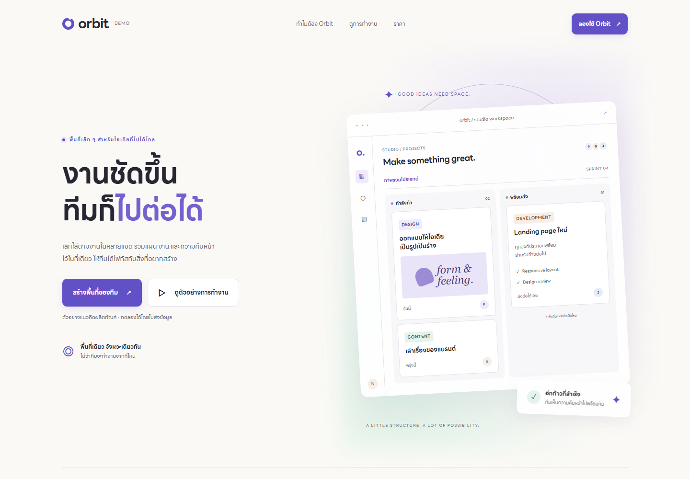
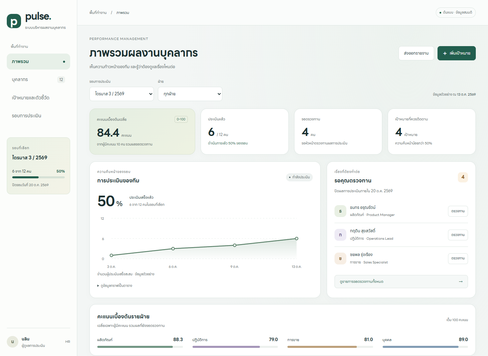
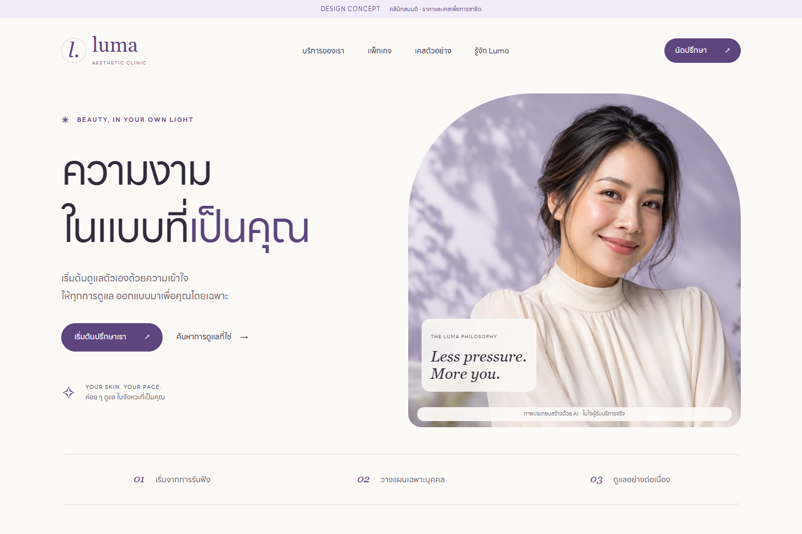
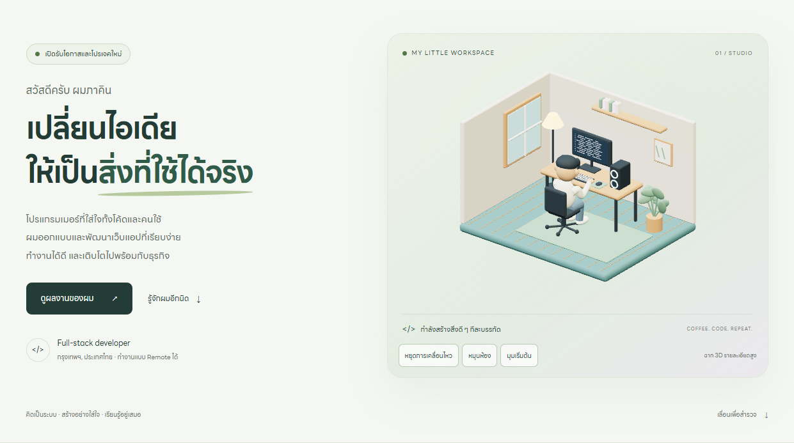

# CodeLV8-ux-ui-agent-skill

Standalone skill **codelv8-ui-ux v1.0.0**: UX reasoning → UI design → implementation → evidence-based QA for web projects in their existing stack.

## Usage

```text
ใช้ $codelv8-ui-ux ออกแบบหน้า CRUD ภาษาไทย โดยยึด framework เดิม
Use $codelv8-ui-ux to redesign this Vue screen and verify keyboard and mobile behavior.
ใช้ $codelv8-ui-ux สร้าง component spec เท่านั้น ไม่ต้องเขียนโค้ด
```

Entrypoint: [SKILL.md](skills/codelv8-ui-ux/SKILL.md). Includes focused references for UX reasoning, screens/redesign, components, source selection, verification and attribution. No dependency on the three original skills or their shared kit. Automatic discovery is enabled through `agents/openai.yaml`.

Existing framework/brand/components take priority. New Thai web UI defaults to restrained Aurora Glassmorphism and locally hosted LINE Seed Sans TH when available and permitted. External components are optional and selected per task; this package does not contain vendor component code or purchase Pro access.

## Overview Demo Cases

แต่ละเคสมี **Prompt เดียวที่รวมไทย + English ไม่เกิน 1,000 ตัวอักษร** (รวมช่องว่างและขึ้นบรรทัดใหม่) คัดลอกทั้ง block เพื่อใช้ได้ทันที ทั้งสองภาษาระบุงานเดียวกัน; UI ที่ได้เป็นภาษาไทย ภาพ Overview เป็น screenshot ของ demo ที่มีอยู่ ไม่ใช่ภาพรับประกันผลจากการรัน Prompt ใหม่

**ก่อน Implement:** ติดตั้ง [codelv8-ui-ux](#install-and-rollback) ทุกเคส Badge `Skill` ระบุ skill ที่ต้องมี; `Plugin/MCP` ระบุการเชื่อมต่อที่ต้องเปิดใช้งานก่อนทำเคสนั้น; `QA` ระบุเครื่องมือ browser verification ที่ต้องเตรียม ตัว `codelv8-ui-ux` ใช้งานเดี่ยวได้ ส่วนเครื่องมือเพิ่มเติมเป็นข้อกำหนดของ Prompt ตัวอย่างนี้

| Case | ผลลัพธ์หลัก | เตรียมเพิ่มจาก codelv8-ui-ux |
|---|---|---|
| [01 · Orbit](#case-01--orbit-landing-page) | SaaS landing + interactive workspace | Playwright CLI สำหรับ QA |
| [02 · Pulse PMS](#case-02--pulse-pms-dashboard) | Dashboard + review/goal modals | Playwright CLI สำหรับ QA |
| [03 · Luma Clinic](#case-03--luma-clinic-landing-page) | Clinic landing + generated images + booking | imagegen และ Playwright CLI |
| [04 · Programmer Portfolio](#case-04--programmer-portfolio) | Portfolio + animated Blender office | 3d-web-experience, Blender MCP และ Playwright CLI |

### Case 01 — Orbit Landing Page

[](skills/codelv8-ui-ux/SKILL.md)
[](demos/orbit-landing/QA.md)

**Overview:** Landing ภาษาไทยสำหรับทีมสร้างสรรค์ โทน ivory/violet/mint มี Board/List, ราคาเดือน/ปี, FAQ และฟอร์มทดลองใน modal ต้องมี Playwright CLI พร้อม browser สำหรับตรวจงาน; ไม่ต้องมี Plugin สร้างภาพหรือ 3D

**Complete Prompt · ไทย + English**

```text
TH: ใช้ $codelv8-ui-ux สร้าง Orbit SaaS landing ภาษาไทยด้วย HTML/CSS/JS: hero, features, workspace สลับ Board/List, ราคาเดือน/ปี, FAQ และฟอร์มทดลองใน modal ใช้ข้อมูลสมมติ Aurora สี ivory/violet/mint, semantic tokens และ LINE Seed Sans TH local รองรับมือถือ/แท็บเล็ต/เดสก์ท็อป มี validation, กันส่งซ้ำ, keyboard/focus, Escape และ reduced motion ไม่ส่งข้อมูลจริง ส่งโค้ด ภาพ Overview และ QA จาก browser จริงด้วย Playwright CLI
EN: Use $codelv8-ui-ux to build a Thai Orbit SaaS landing in HTML/CSS/JS with hero, features, Board/List workspace, monthly/yearly pricing, FAQ and demo-form modal. Use fictional data, ivory/violet/mint Aurora tokens and local LINE Seed Sans TH. Support mobile/tablet/desktop, validation, duplicate-submit protection, keyboard/focus, Escape and reduced motion; no data delivery. Deliver code, overview screenshot and real-browser QA with Playwright CLI.
```



[Demo](demos/orbit-landing/index.html) · [Design / Run](demos/orbit-landing/DESIGN.md) · [Browser QA](demos/orbit-landing/QA.md)

### Case 02 — Pulse PMS Dashboard

[](skills/codelv8-ui-ux/SKILL.md)
[](demos/pms-dashboard/tests/QA.md)

**Overview:** Performance Management System สำหรับ HR/หัวหน้าทีม มี KPI, ตัวกรองรอบ/ฝ่าย, รายชื่อบุคลากร, detail/review/goal modals และ CSV ข้อมูลสมมติเปลี่ยนใน memory; เตรียม Playwright CLI พร้อม browser สำหรับ QA

**Complete Prompt · ไทย + English**

```text
TH: ใช้ $codelv8-ui-ux ทำ Pulse PMS (Performance Management System) ภาษาไทยด้วย HTML/CSS/JS ใช้บุคลากรสมมติ 12 คน/4 ฝ่าย มี KPI, กราฟ, ตัวกรองรอบ/ฝ่าย, ค้นหา/แบ่งหน้า, detail/review tabs และ modal เพิ่มเป้าหมาย/บันทึกคะแนน มี validation, กันส่งซ้ำ/ปิดเมื่อแก้ค้าง รักษาตัวกรอง ส่ง CSV ป้องกัน formula injection รอบเก่าอ่านอย่างเดียว ใช้ Aurora sage และ LINE Seed Sans TH local รองรับ 320–1440px, keyboard/reduced motion ไม่มี backend ส่งโค้ด ภาพ Overview และ Playwright CLI QA
EN: Build a Thai Pulse performance dashboard with $codelv8-ui-ux in HTML/CSS/JS: 12 fictional staff/4 departments, KPIs, chart, cycle/department filters, search/paging, detail/review tabs and goal/score modals. Validate, prevent duplicate saves and dirty close, preserve filters, export formula-safe CSV; past cycles read-only. Use sage Aurora/local LINE Seed Sans TH, 320–1440px, keyboard/reduced motion; no backend. Deliver code, overview screenshot and Playwright CLI browser QA.
```



[Demo](demos/pms-dashboard/index.html) · [Design / Run](demos/pms-dashboard/DESIGN.md) · [Browser QA](demos/pms-dashboard/tests/QA.md)

### Case 03 — Luma Clinic Landing Page

[](skills/codelv8-ui-ux/SKILL.md)
[](demos/clinic-landing/IMAGE-PROMPTS.md)
[](demos/clinic-landing/tests/QA.md)

**Overview:** Beauty clinic landing โทน cream/lavender พร้อมภาพ AI 2 ภาพ, 3 แพ็กเกจ, 3 เคสสมมติ, filters/detail dialogs และจำลองจอง ต้องมี skill `imagegen` พร้อม image-generation tool และ Playwright CLI ก่อน Implement; badge imagegen ลิงก์ไปยัง prompts/หลักฐานภาพของเคส

**Complete Prompt · ไทย + English**

```text
TH: ใช้ $codelv8-ui-ux และ $imagegen สร้าง Luma คลินิกความงามสมมติ ภาษาไทยด้วย HTML/CSS/JS โทน cream/lavender Aurora, LINE Seed Sans TH local มี hero, บริการ, 3 แพ็กเกจ/3 เคสสมมติ, filters/detail dialogs, FAQ และ modal จำลองจอง สร้างภาพ hero/คลินิก 2 ภาพ ระบุว่า AI ไม่ใช่คนไข้/ผลรักษา ไม่อ้าง before-after หรือรับประกันผล ไม่เก็บข้อมูลสุขภาพ/ส่งข้อมูล มี validation, กันส่งซ้ำ, keyboard/focus, reduced motion และ responsive ส่งโค้ด ภาพ Overview, asset prompts และ Playwright CLI QA
EN: Use $codelv8-ui-ux/$imagegen for a fictional Thai Luma clinic landing in HTML/CSS/JS: cream/lavender Aurora, local LINE Seed Sans TH, hero, services, 3 packages/3 cases, filters/detail dialogs, FAQ and booking modal. Generate 2 hero/interior images labeled AI, not patients/results; no before-after claims, guarantees, health-data collection or delivery. Add validation, duplicate protection, keyboard/focus, reduced motion and responsive layouts. Deliver code, overview, asset prompts and Playwright CLI QA.
```



[Demo](demos/clinic-landing/index.html) · [Design / Run](demos/clinic-landing/DESIGN.md) · [Image prompts](demos/clinic-landing/IMAGE-PROMPTS.md) · [Browser QA](demos/clinic-landing/tests/QA.md)

### Case 04 — Programmer Portfolio

[](skills/codelv8-ui-ux/SKILL.md)
[](demos/programmer-portfolio/DESIGN.md)
[](demos/programmer-portfolio/DESIGN.md)
[](demos/programmer-portfolio/QA.md)

**Overview:** Portfolio ภาษาไทยพร้อมห้องทำงาน Blender และตัวละครใส่แว่นพิมพ์คอมพิวเตอร์ มี animation/camera controls, project dialogs และภาพ fallback เตรียม skill `3d-web-experience`, Blender พร้อม MCP ที่เชื่อมต่อได้ และ Playwright CLI; badge 3D/Blender ลิงก์ไปยังข้อกำหนดและ assets ของเคสนี้ ภาพแสดงตัวละคร procedural เดิมที่คืนค่าแล้ว

**Complete Prompt · ไทย + English**

```text
TH: ใช้ $codelv8-ui-ux และ $3d-web-experience สร้าง Portfolio โปรแกรมเมอร์ภาษาไทย HTML/CSS/JS + Three.js local โทน sage Aurora/LINE Seed Sans TH local มีประวัติ ทักษะ project modals และ contact สมมติ ใช้ Blender MCP สร้างห้อง original กับคนใส่แว่นพิมพ์คอม มี animation, pause/rotate/reset, GLB desktop/mobile และ PNG fallback สำรอง scene ก่อนแก้ รองรับ 320–1440px, keyboard/focus, reduced motion หยุด render เมื่อซ่อน ไม่มีการส่งข้อความ ส่งโค้ด .blend/GLB ภาพ Overview และ Playwright CLI QA รวม WebGL/model failure
EN: Use $codelv8-ui-ux/$3d-web-experience: Thai portfolio, HTML/CSS/JS + local Three.js, sage Aurora/local LINE Seed Sans TH, bio, skills, project modals, fictional contact. Blender MCP: original office/glasses-wearing typist, animation, pause/rotate/reset, desktop/mobile GLBs, PNG fallback. Back up scenes. Support 320–1440px, keyboard/focus, reduced motion, render pause when hidden; no messages. Deliver code, .blend/GLBs, overview, Playwright CLI QA for WebGL/model failures.
```



[Demo](demos/programmer-portfolio/index.html) · [Design / Run / Assets](demos/programmer-portfolio/DESIGN.md) · [Browser QA](demos/programmer-portfolio/QA.md)

ทุกเคสใช้ข้อมูลสมมติ ภาพแสดงเฉพาะ viewport Overview; ตรวจ interaction และข้อจำกัดใน Browser QA ของแต่ละเคส Portfolio ต้องเปิดผ่าน HTTP ตาม Design / Run

## Install and rollback

From the repository root in PowerShell, for a **new, absent** target:

```powershell
$skillSource = (Resolve-Path -LiteralPath '.\skills\codelv8-ui-ux').Path
$skillTarget = Join-Path $env:USERPROFILE '.codex\skills\codelv8-ui-ux'
if (Test-Path -LiteralPath $skillTarget) { throw 'Target exists: back up this skill before replacing it.' }
Copy-Item -LiteralPath $skillSource -Destination $skillTarget -Recurse
```

For updates, back up only this target, stage the new copy, verify file inventory and SHA-256 hashes, then replace it. Do not overwrite unrelated skills. For rollback, move only the verified installed `codelv8-ui-ux` directory to a quarantine/backup location and restore its prior backup if one exists. A fresh installation has no prior version to restore.

Reversible rollback for this fresh installation (preview the exact paths before moving):

```powershell
$skillTarget = [IO.Path]::GetFullPath((Join-Path $env:USERPROFILE '.codex\skills\codelv8-ui-ux'))
$expectedTarget = [IO.Path]::GetFullPath((Join-Path $env:USERPROFILE '.codex\skills\codelv8-ui-ux'))
if ($skillTarget -ne $expectedTarget) { throw 'Unexpected rollback target' }
if ((Get-Item -LiteralPath $skillTarget).Attributes -band [IO.FileAttributes]::ReparsePoint) { throw 'Refuse linked rollback target' }
$backupRoot = Join-Path $env:USERPROFILE '.codex\skill-backups'
$skillRollback = Join-Path $backupRoot ('codelv8-ui-ux-' + [guid]::NewGuid().ToString('N'))
Get-Item -LiteralPath $skillTarget
Write-Output $skillRollback
# After reviewing those exact paths:
New-Item -ItemType Directory -Path $backupRoot -Force | Out-Null
Move-Item -LiteralPath $skillTarget -Destination $skillRollback
```

If Codex does not discover a newly installed skill in the current chat, start a new chat/session. No agent settings changes are required.

## Validation and evidence

Use the installed `skill-creator` validator when available:

```powershell
python -X utf8 "$env:USERPROFILE\.codex\skills\.system\skill-creator\scripts\quick_validate.py" '.\skills\codelv8-ui-ux'
```

Behavioral requests and acceptance criteria: [tests/scenarios.md](tests/scenarios.md). Current obtained evidence and limits: [tests/validation-report.md](tests/validation-report.md).

Structural validation proves package consistency, not design quality. Browser checks on evaluation fixtures prove those artifacts only. Automated accessibility results do not prove full WCAG compliance, user approval, or production/backend readiness. Skipped checks remain not verified.

